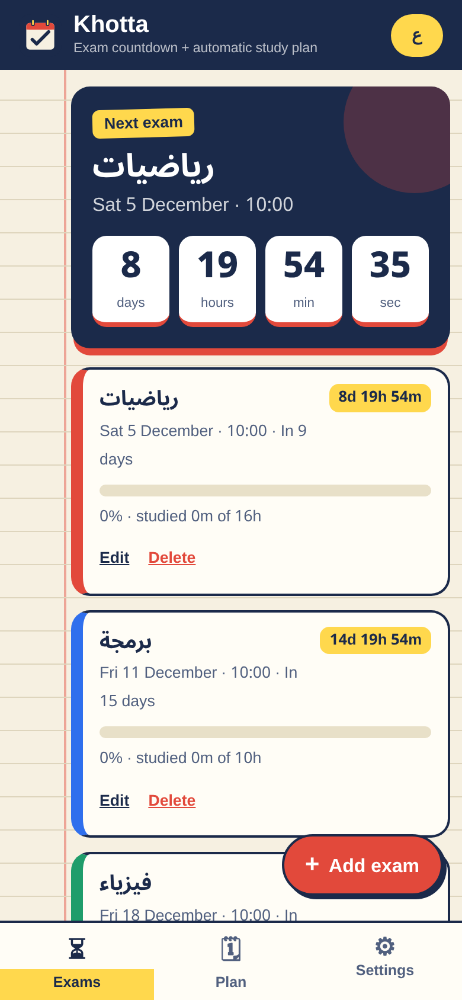
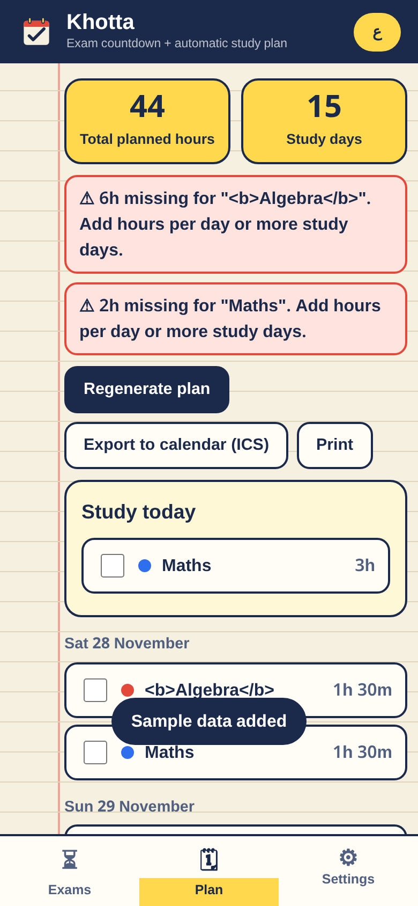
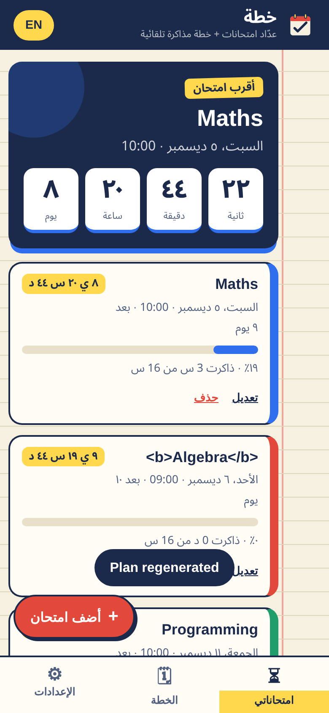
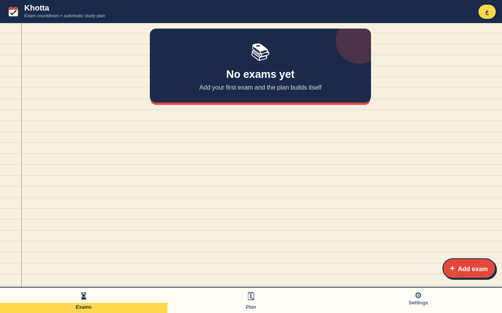
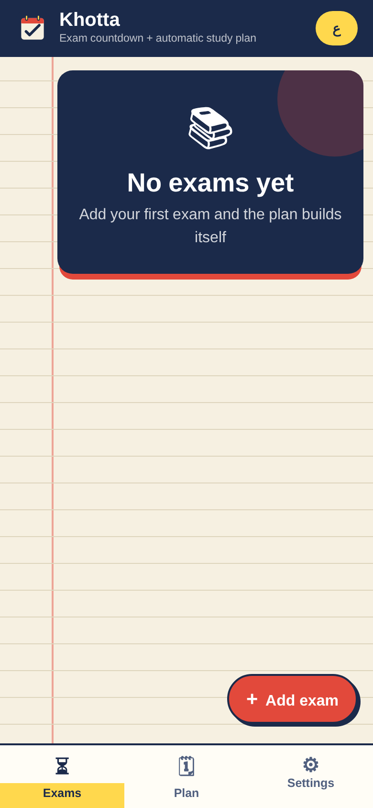

<p align="center"></p>

# Khotta · خطة

**Add your exams. Get a day-by-day study plan in one tap.**
أضف امتحاناتك واحصل على خطة مذاكرة يوم بيوم.

**Live demo:** https://yousefkhames.github.io/khotta/

Khotta is a small static web app for students. It shows a live countdown to each exam and builds a study plan from three things you give it: your exams (date, difficulty, hours you need), the weekdays you can study, and how many hours you can study per day. Arabic (RTL) and English.

<p align="center">



</p>

## Screenshots

Captured from the live site (https://yousefkhames.github.io/khotta/).

<p>
  
  
</p>

## Features

- Live countdown (days, hours, minutes, seconds) to the next exam, plus a countdown chip on every exam.
- Automatic plan: spreads each subject's hours over your study days, never on or after the exam day, in 30-minute steps. The subject with the tightest deadline goes first, so nothing is left for the last night.
- Honest warnings: if your hours per day cannot cover a subject, Khotta says how much is missing instead of hiding it.
- Check off sessions. Progress bars per subject. Missed sessions are rescheduled automatically on later days.
- Changing exams or settings rebuilds the plan and keeps what you already finished.
- Export the plan to your calendar (.ics), print it, back up and restore as JSON.
- Arabic and English, full RTL, mobile first, works offline after the first visit (service worker).

## Tech

Plain HTML, CSS and JavaScript. No framework, no build step, no server, no tracking. Data is stored in `localStorage`. The planning engine (`plan.js`) is a pure module with no DOM code, used both by the app and by the tests.

## Run and test

```
python3 -m http.server 8000   # then open http://localhost:8000
npm test                      # 18 unit tests incl. 500 randomized scenarios
npm i && npm run e2e          # real Chrome click-through (needs Chrome, set BASE to the URL)
```

## Honest limits

- Data lives in one browser on one device. There is no account and no sync. Clearing browser data erases it, so use Backup.
- GitHub Pages is a free demo host. For real use, host the files yourself.
- The planner is a simple greedy scheduler, not an optimizer. It does not know your timetable, and it does not split a day into clock times (calendar export places sessions back to back from your chosen start hour).
- Hours per subject are your estimate. The difficulty setting only suggests a default (6, 10 or 16 hours).
- Countdown uses your device clock and time zone.

## License

MIT
